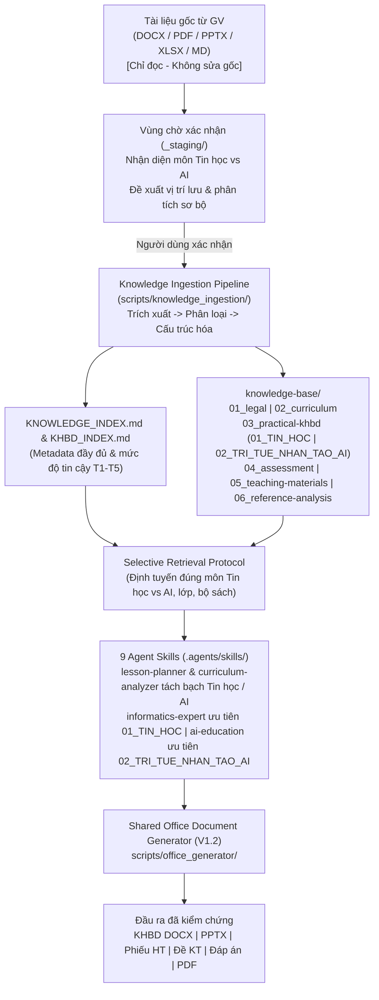

# KIẾN TRÚC NÂNG CẤP VIETNAMESE TEACHER AI SKILLS – V2.0
**Chủ đề kiến trúc:** Evidence-Based Teaching Knowledge Base  
**Trạng thái:** Đề xuất kiến trúc & Chuẩn bị hạ tầng (Chưa phát hành V2.0 chính thức — chờ tiếp nhận tài liệu thực chiến theo từng đợt và hoàn tất kiểm thử bắt buộc)  
**Ngày lập:** 24/11/2026

---

## 1. Báo cáo hiện trạng kiến trúc V1.2 (Đã kiểm tra thực tế)

### 1.1. Thành phần đang vận hành ổn định ở V1.2
1. **9 Agent Skills (`.agents/skills/*/SKILL.md`):** `ai-education`, `ai-video-creator`, `assessment-generator`, `curriculum-analyzer`, `digital-competency`, `informatics-expert`, `lesson-planner`, `slide-designer`, `teaching-assistant`. Tất cả **9/9 Skill** vượt qua `scripts/validate_skills.py` và đã tích hợp chỉ dẫn gọi chung `scripts/office_generator/cli.py`.
2. **Tài liệu nguyên tắc & khung mẫu (`references/`):** 4 tệp Markdown (`vietnam-education-guidance.md`, `lesson-plan-template.md`, `assessment-template.md`, `ai-literacy-framework.md`).
3. **Shared Office Document Generator (`scripts/office_generator/` + `templates/office/`):**
   - API thống nhất `generate_document(...)` và `run_batch(...)`; CLI đa lệnh (`docx`, `pptx`, `pdf`, `validate`, `batch`).
   - 7 cấu hình DOCX chuẩn giáo dục Việt Nam (`khbd`, `exam`/`assessment`, `matrix`, `answer_key`, `study_material`, `teacher_guide`, `general`) và 3 theme PPTX (`education`, `lesson`, `assessment`) với 13 bố cục trình chiếu + Speaker Notes.
   - Bộ kiểm định dùng chung `validator.py` đối chiếu nguồn Markdown và phân tách `file_error`, `content_error`, `format_warning`, `unconvertible`.
4. **Sản phẩm kiểm thử thực tế hiện có (`output/tin-hoc-10-kntt-bai-16/`):** Trọn bộ 14 tệp (5 Markdown nguồn, 4 DOCX, 1 PPTX 18 slide, Speaker Notes, mã Python kiểm chứng, `batch_config.json`, báo cáo kiểm định `0 errors, 0 warnings`).

### 1.2. Các điểm kỹ thuật phát hiện qua kiểm tra hiện trạng trước khi lên V2.0
1. **Khoảng trống tri thức thực tế (Lý do cần V2.0):** Repository chưa có văn bản pháp lý chính thức (Thông tư/Công văn gốc), chưa có tài liệu SGK/PPCT gốc và chưa có KHBD thực chiến hay đề kiểm tra thực tế từ giáo viên.
2. **Thư viện Python cho Pipeline nạp tài liệu đa định dạng:**
   - Đã cài sẵn: `python-docx 1.2.0`, `python-pptx 1.0.2`, `Pillow 13.0.0`, `lxml 6.1.3` → sẵn sàng đọc DOCX, PPTX, Markdown.
   - Chưa cài đặt: thư viện đọc **PDF** (`pypdf` / `pdfplumber`) và **XLSX** (`openpyxl`) → cần bổ sung vào `scripts/knowledge_ingestion/requirements.txt` khi triển khai pipeline nạp PDF/XLSX.
3. **Đường dẫn kiểm thử V1.2 bị lệch sau khi dọn thư mục `output/`:** Hai test V1.2 (`test_parser.py` và `test_pptx.py`) trước đó trỏ tới `output/bai-16-tin-hoc-10/02_Kich_ban_PowerPoint.md` (đã được dọn và thay bằng `output/tin-hoc-10-kntt-bai-16/03_Kich_ban_Slide_Bai_16.md`). Đã cập nhật lại 2 test này để bảo đảm toàn bộ 14/14 test nền V1.2 luôn xanh.

---

## 2. Đề xuất kiến trúc V2.0 – Evidence-Based Teaching Knowledge Base

### 2.1. Phân tách tri thức theo 6 nhóm, 2 kho KHBD độc lập & Phân tầng tin cậy (Trust Hierarchy)
- **`01_legal/` (T1 – Pháp lý chính thức):** Văn bản Bộ GDĐT, Sở GDĐT, quy định trường. Chỉ nhóm này được dùng để kết luận tính pháp lý, biểu mẫu bắt buộc hoặc mã năng lực số chính thức.
- **`02_curriculum/` (T2 – Chương trình chuẩn):** Chương trình GDPT 2018, PPCT, tài liệu SGK/SGV chính thức (tách bạch chương trình Tin học chính thức với chương trình/chuyên đề AI). Căn cứ xác định YCCĐ, số tiết, giới hạn khối lớp.
- **`03_practical-khbd/` (T4 – Thực chiến tham khảo, quản lý qua `KHBD_INDEX.md`):** Tách thành **hai kho độc lập** kèm vùng chờ xác nhận:
  - **`01_TIN_HOC/`:** Tổ chức theo khối `khoi-10/`, `khoi-11/`, `khoi-12/` (`bo-sach/`, `chu-de/`, `bai-thuc-hanh/`, `du-an-stem/`, `khbd-mau-thuc-chien/`) và `best-practices/`.
  - **`02_TRI_TUE_NHAN_TAO_AI/`:** Tổ chức theo khối `khoi-10/`, `khoi-11/`, `khoi-12/` (`chu-de-ai/`, `thuc-hanh-ai/`, `du-an-ai/`, `ung-dung-ai/`, `dao-duc-va-trach-nhiem-ai/`, `khbd-mau-thuc-chien/`) và `best-practices/`.
  - **`_staging/`:** Lưu tạm tài liệu mới tiếp nhận khi chưa được người dùng xác nhận phân loại và vị trí lưu chính thức.
  - **Luật phân tách bắt buộc:** Cấm suy diễn quy định pháp lý từ KHBD mẫu; cấm áp dụng máy móc phương pháp dạy Tin học cho AI; cấm dùng tài liệu AI thay thế nội dung Tin học; chỉ kết hợp hai kho khi người dùng yêu cầu bài học liên môn.
- **`04_assessment/` (T3 – Chuyên môn đánh giá):** Ma trận, đặc tả, đề kiểm tra, rubric thực tế.
- **`05_teaching-materials/` (T4 – Học liệu dạy học):** Phiếu học tập, slide mẫu, bộ dữ liệu, bài lab.
- **`06_reference-analysis/` (T5 – Tri thức phân tích dẫn xuất):** Các tệp `.md` đã chuẩn hóa do pipeline sinh ra (trích xuất cấu trúc KHBD, phương pháp dạy học, hoạt động GV–HS, sản phẩm & đánh giá), luôn trỏ ngược về đường dẫn tệp gốc và không bao giờ ghi đè tệp gốc.

### 2.2. Thiết kế Pipeline phân tích tài liệu 10 bước (`scripts/knowledge_ingestion/` – sẽ triển khai khi nạp Đợt 1)
1. **Tiếp nhận tài liệu gốc:** Hỗ trợ `.docx`, `.pdf`, `.pptx`, `.xlsx`, `.md`; đặt nguyên bản vào nhóm thư mục `01..05` tương ứng (chỉ đọc, không sửa nội dung gốc).
2. **Trích xuất nội dung thô:** Đọc văn bản, bảng biểu, ghi chú slide, số trang/sheet bằng `python-docx`, `python-pptx`, `pypdf`/`pdfplumber`, `openpyxl`.
3. **Phân tích cấu trúc:** Tách đề mục, bảng biểu, danh sách, mã nguồn, phần thông tin hành chính.
4. **Nhận diện bản chất nội dung:** Gắn nhãn rõ *pháp lý* (`T1`), *chương trình/chuyên môn* (`T2/T3`), hay *thực chiến tham khảo* (`T4`).
5. **Trích xuất phương pháp dạy học:** Kỹ thuật dạy học, phân hóa, tương tác lớp học.
6. **Trích xuất cấu trúc KHBD:** Cách chia pha (Khởi động – Hình thành KT – Luyện tập – Vận dụng), thời lượng, biểu mẫu.
7. **Trích xuất hoạt động GV & HS:** Nhiệm vụ chuyển giao, thao tác thực hiện, câu hỏi gợi mở, dự kiến trả lời.
8. **Trích xuất sản phẩm học tập & đánh giá:** Phiếu học tập, bài thực hành, bảng kiểm, rubric.
9. **Tạo tài liệu tri thức Markdown có cấu trúc** trong `knowledge-base/06_reference-analysis/` (giữ nguyên dẫn chiếu tới nguồn gốc).
10. **Cập nhật `KNOWLEDGE_INDEX.md`** với đầy đủ 12 cột metadata và kiểm tra hợp lệ chỉ mục.

### 2.3. Giao thức truy xuất có chọn lọc (Selective Retrieval) cho 9 Agent Skills
- **Không nhồi toàn bộ Knowledge Base vào `SKILL.md` và không đọc toàn bộ KB cho mọi yêu cầu.**
- Quy trình chuẩn 4 bước trong mỗi Skill (khi tích hợp V2.0):
  1. Đọc `KNOWLEDGE_INDEX.md` trước để lọc tài liệu khớp theo *Loại tài liệu, Môn học, Cấp học, Khối lớp, Bộ sách, Chủ đề* và cột *Các Skill được phép khai thác*.
  2. Chỉ đọc các tệp liên quan trực tiếp (ưu tiên bản phân tích ở `06_reference-analysis/` và đối chiếu tệp gốc khi cần trích dẫn chính xác).
  3. Áp dụng luật ưu tiên nguồn: **yêu cầu pháp lý/chuẩn** ưu tiên `01_legal` & `02_curriculum`; **thiết kế hoạt động dạy học thực tế** ưu tiên kết hợp `02_curriculum` (YCCĐ) + `03_practical-khbd` (kinh nghiệm tổ chức); luôn ghi rõ nguồn nào thuộc loại nào.
  4. Bắt buộc trích dẫn `[Tên tài liệu – Đường dẫn – Mục/Trang]` cho nội dung khai thác; nếu KB không có dữ liệu thì tuyên bố rõ chưa có dữ liệu thay vì bịa đặt.

### 2.4. Kết nối Knowledge Base → Office Document Generator (V1.2)
- Đầu ra Markdown do 9 Skill tổng hợp từ Knowledge Base (có trích dẫn nguồn minh bạch) đi thẳng vào `scripts/office_generator/cli.py` (hoặc `batch`) để xuất:
  - KHBD DOCX (`--template khbd`)
  - PowerPoint PPTX (`--template education` / `lesson` / `assessment`)
  - Phiếu học tập DOCX (`--template study_material`)
  - Đề kiểm tra DOCX (`--template exam` / `matrix`)
  - Đáp án & hướng dẫn chấm DOCX (`--template answer_key`)
  - PDF (`cli.py pdf` khi máy có LibreOffice/`docx2pdf`)

---

## 3. Kế hoạch chi tiết các file cần thêm và cần sửa

### A. Đã khởi tạo ở Giai đoạn chuẩn bị hạ tầng & Tách kho KHBD (hiện tại)
- **Tạo mới hạ tầng Knowledge Base trống (0 tài liệu giả):**
  - `knowledge-base/01_legal/.gitkeep`, `02_curriculum/.gitkeep`, `03_practical-khbd/.gitkeep`, `04_assessment/.gitkeep`, `05_teaching-materials/.gitkeep`, `06_reference-analysis/.gitkeep`
  - **Hai kho KHBD độc lập & vùng chờ trong `knowledge-base/03_practical-khbd/`:**
    - `01_TIN_HOC/` (`khoi-10/`, `khoi-11/`, `khoi-12/` × `bo-sach/`, `chu-de/`, `bai-thuc-hanh/`, `du-an-stem/`, `khbd-mau-thuc-chien/` + `best-practices/` + `README.md`)
    - `02_TRI_TUE_NHAN_TAO_AI/` (`khoi-10/`, `khoi-11/`, `khoi-12/` × `chu-de-ai/`, `thuc-hanh-ai/`, `du-an-ai/`, `ung-dung-ai/`, `dao-duc-va-trach-nhiem-ai/`, `khbd-mau-thuc-chien/` + `best-practices/` + `README.md`)
    - `_staging/.gitkeep` & `knowledge-base/03_practical-khbd/README.md`
  - **Tài liệu quản trị & kiến trúc:** `knowledge-base/README.md`, `KNOWLEDGE_INDEX.md`, `KHBD_INDEX.md`, `V2.0_ARCHITECTURE.md`, `KNOWLEDGE_INGESTION_GUIDE.md`.
- **Cập nhật định tuyến hai kho KHBD cho 4 Skill trọng tâm (giữ nguyên toàn bộ logic V1.2):**
  - `.agents/skills/lesson-planner/SKILL.md` (nhận diện môn học, chọn đúng kho Tin học vs AI, chỉ kết hợp khi liên môn).
  - `.agents/skills/curriculum-analyzer/SKILL.md` (phân biệt chương trình Tin học và chương trình AI, kiểm tra căn cứ YCCĐ).
  - `.agents/skills/informatics-expert/SKILL.md` (ưu tiên `01_TIN_HOC/`, tham chiếu liên môn có kiểm soát).
  - `.agents/skills/ai-education/SKILL.md` (ưu tiên `02_TRI_TUE_NHAN_TAO_AI/`, tham chiếu liên môn có kiểm soát).
- **Khắc phục 2 đường dẫn kiểm thử nền V1.2:**
  - `tests/office_generator/test_parser.py` & `tests/office_generator/test_pptx.py` (cập nhật trỏ tới tệp kịch bản Bài 16 đang tồn tại `output/tin-hoc-10-kntt-bai-16/03_Kich_ban_Slide_Bai_16.md`).

### B. Dự kiến thêm & sửa ở các đợt tiếp theo (sau khi người dùng cung cấp tài liệu thực chiến)
- **Thêm mới Pipeline nạp & truy xuất tri thức:**
  - `scripts/knowledge_ingestion/__init__.py`
  - `scripts/knowledge_ingestion/extractors.py` (DOCX, PDF, PPTX, XLSX, Markdown)
  - `scripts/knowledge_ingestion/analyzer.py` (tự nhận diện Tin học vs AI, phân loại pháp lý/chuyên môn/thực chiến, trích xuất cấu trúc KHBD, hoạt động GV–HS, sản phẩm & đánh giá)
  - `scripts/knowledge_ingestion/indexer.py` (cập nhật và kiểm tra hợp lệ `KNOWLEDGE_INDEX.md` & `KHBD_INDEX.md`)
  - `scripts/knowledge_ingestion/retriever.py` (truy vấn có chọn lọc theo Skill, môn, lớp, bộ sách, chủ đề, mức độ tin cậy)
  - `scripts/knowledge_ingestion/cli.py` & `requirements.txt`
- **Cập nhật 5 file `.agents/skills/*/SKILL.md` còn lại** (`assessment-generator`, `digital-competency`, `slide-designer`, `ai-video-creator`, `teaching-assistant`): bổ sung mục ngắn gọn *Tra cứu Knowledge Base (V2.0)* khi bắt đầu nạp tài liệu thực chiến — không viết lại nội dung chuyên môn V1.2.
- **Thêm bộ kiểm thử V2.0 (`tests/knowledge_base/`):** Kiểm thử đủ 9 hạng mục bắt buộc + kiểm thử tách bạch kho Tin học và kho Trí tuệ nhân tạo (AI).
- **Tạo `TEST_REPORT_V2.md` & cập nhật `CHANGELOG.md` (V2.0.0):** Chỉ thực hiện **sau khi** đã nạp tài liệu thực chiến và vượt qua toàn bộ hạng mục kiểm thử bắt buộc.
